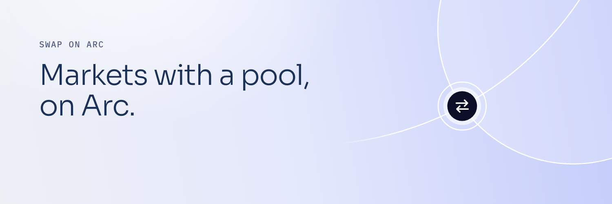
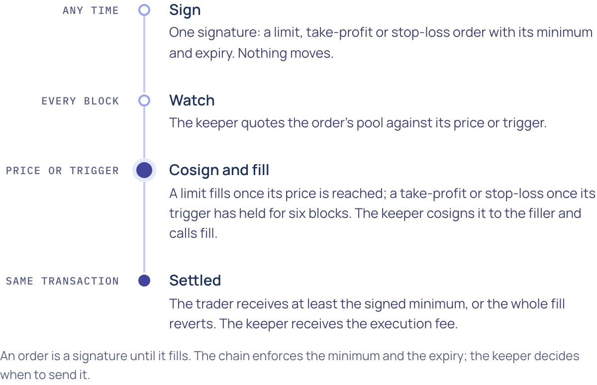

<p align="center">
  <picture>
    <source media="(prefers-color-scheme: dark)" srcset="assets/banner-dark.png">
    
  </picture>
</p>

<p align="center">
  
</p>

<h1 align="center">mercurifi trade · contracts</h1>

<p align="center">
  <a href="deployments/manifest-5042002.json"></a>
  <a href="#deployment"></a>
  <a href="#build-and-verify"></a>
  <a href="foundry.toml"></a>
  <a href="src/MercuriOrderFiller.sol"></a>
  <a href="LICENSE"></a>
</p>

<p align="center">
  <a href="https://trade.mercuri.finance">trade.mercuri.finance</a> ·
  <a href="https://docs.mercuri.finance/trade">docs.mercuri.finance/trade</a> ·
  <a href="https://trade-api.mercuri.finance/v1/pools">public API</a>
</p>

The Solidity source of **[trade.mercuri.finance](https://trade.mercuri.finance)**, the DEX for USDC pools on Arc: the
ones mercurifi launch graduates into and the listed Arc assets. It is a separate product with a separate contract set:
Launch's deployed contracts stay in
[mercuri-launch-contracts](https://github.com/mercuri-finance/mercuri-launch-contracts) and are never changed for Trade;
anything Trade needs on chain lives here. Contracts, the pinned upstream sources they compile against, the testnet
deployment inputs and the release evidence. The backend, the keeper and the web app are separate and not published.

Spot swaps go through Uniswap's Universal Router and Permit2 into the Uniswap v4 pools on Arc; the 1% trade fee on a
graduated token's pool is Launch's hook, unchanged. Listed Arc assets pay an app fee to the treasury as a command in
the router plan the trader signs. Limit, take-profit and stop-loss orders are UniswapX V3 Dutch orders, cosigned at
fill time by the backend keeper and filled through the one contract this repository adds.

**Contents** · [Deployment](#deployment) · [How it works](#how-it-works) · [Contracts](#contracts) ·
[Parameters](#parameters) · [Events](#events) · [Build and verify](#build-and-verify) · [Security](#security) ·
[License](#license)

## Deployment

None yet. Trade adds no deployed contract of its own today. The first will be the filler for the hosted keeper, with
the pinned UniswapX reactor, on Arc testnet first. That needs its own review, deployment record and release evidence
in this repository before orders open on either network.

The testnet inputs are in [`deployments/manifest-5042002.json`](deployments/manifest-5042002.json). The reactor fee
owner is Launch's TimelockController on the same network, and the deployment scripts require it to equal `timelock` in
Launch's deployment record. The execution fee recipient (the keeper) ships as a sentinel, and the filler script
refuses to run until it is set.

| Dependency | Address (testnet, chain 5042002) | Mutability |
| --- | --- | --- |
| Universal Router | [`0x4fcA4a51Ab4F23A7447b3284fBd7D73289A89Fb1`](https://explorer.testnet.arc.io/address/0x4fcA4a51Ab4F23A7447b3284fBd7D73289A89Fb1) | immutable · upstream |
| Permit2 | [`0x000000000022D473030F116dDEE9F6B43aC78BA3`](https://explorer.testnet.arc.io/address/0x000000000022D473030F116dDEE9F6B43aC78BA3) | immutable · upstream |
| Launch hook | [`0x87e6BaBAc4598F99f4A0717ad294934455Fe60cc`](https://explorer.testnet.arc.io/address/0x87e6BaBAc4598F99f4A0717ad294934455Fe60cc) | immutable · mercurifi launch |
| USDC | [`0x3600000000000000000000000000000000000000`](https://explorer.testnet.arc.io/address/0x3600000000000000000000000000000000000000) | Arc system contract · upstream |

## How it works

<p align="center">
  <picture>
    <source media="(prefers-color-scheme: dark)" srcset="assets/order-flow-dark.png">
    
  </picture>
</p>

1. **Sign.** The trader signs a limit, take-profit or stop-loss order as a UniswapX V3 Dutch order. Nothing moves
   until it is filled.
2. **Cosign.** At fill time the keeper cosigns the order, exclusive to this filler, and calls `fill` with the one
   USDC pool to use. Only the configured keeper can call `fill`.
3. **Settle.** The reactor checks the signature, nonce and deadline and calls back. The filler swaps on that pool
   through the Universal Router: a Launch pool pays Launch's hook fee, any other USDC pool pays the app fee.
4. **Pay out.** The trader receives every output above what the reactor takes; a fixed USDC execution fee goes to
   the keeper. If the trader's balance did not rise by the signed minimum, the whole fill reverts and no fee is paid.

## Contracts

| File | Role | Mutability |
| --- | --- | --- |
| [`MercuriOrderFiller.sol`](src/MercuriOrderFiller.sol) | The filler the keeper uses against the UniswapX reactor. Builds a single-pool swap, enforces net output and full input consumption, hands all surplus to the signed trader and pays the execution fee. No owner, pause, upgrade or rescue path. | immutable, not deployed |

The one Universal Router entry point the filler calls is in [`interfaces/IOrderSwapRouter.sol`](src/interfaces/IOrderSwapRouter.sol).

Pinned sources it builds against:

| Path | What it is | Status |
| --- | --- | --- |
| `lib/uniswapx` | The 34-file compiler closure of Uniswap/UniswapX `eb7ce07` for `V3DutchOrderReactor` | Unchanged upstream sources, checksummed in `source-manifest.json` |
| `lib/universal-router` | The 110-file closure of Uniswap/universal-router `999d561`, the revision behind Arc's router `0x4fcA…9Fb1` | Unchanged upstream sources, checksummed; builds separately with `script/build-trade-router.sh` |
| `lib/mercuri-launch-contracts` | Launch's deployed sources and its pinned Uniswap v4, Permit2, OpenZeppelin and forge-std trees | Git submodule, pinned |
| `test/` | The router swap, UniswapX filler and order invariants, the fork invariants and the local-state tests, with the Launch fixtures they need | Local |

## Parameters

Fixed in the filler's bytecode at deployment; a change means a new filler (see
[`docs/runbooks/filler-replacement.md`](docs/runbooks/filler-replacement.md)). That includes a new Launch hook: pools of
any hook other than the filler's `launchHook` are charged the app fee and lose Launch's referral credit.

| Parameter | Value |
| --- | --- |
| App fee | 50 bps of the USDC side on listed pools (`APP_FEE_BPS`); none on Launch pools, which pay Launch's hook fee. On a buy it is computed on the gross signed input, which includes the execution fee |
| Execution fee | at most 0.10 USDC (`MAX_EXECUTION_FEE`); the testnet manifest sets 0.05 USDC; zero disables it |
| Execution fee recipient | the keeper's transaction address, also the only address allowed to call `fill` |
| App fee recipient | the treasury, the same one Launch uses |

Graduated tokens pay Launch's hook fee, split by Launch's FeeManager, on every pool swap whichever app sent it.
Listed Arc assets pay the fixed 50 bps app fee on the USDC side, paid to the treasury inside the router plan; the API
refuses to trade a listed pool while no recipient is configured. Orders carry the same app recipient, so a fill pays
the same fee at settlement. One treasury serves both products; which product a fee came from is told by the contract
that paid it.

## Events

For indexers and the keeper.

```solidity
// MercuriOrderFiller
event OrderFilled(bytes32 indexed orderHash, address indexed swapper, bytes32 indexed poolId);
```

`orderHash` is the trader-signed order hash the reactor's `Fill` event carries; `poolId` is
`keccak256(abi.encode(key))` of the pool used.

A public read API lists the pools Trade routes to on mainnet:
[`trade-api.mercuri.finance/v1/pools`](https://trade-api.mercuri.finance/v1/pools), and `/v1/network` names the order
reactor and cosigner, both empty while orders are closed.

## Build and verify

```sh
git submodule update --init --recursive
# The two upstream closures are unchanged:
python3 script/check-trade-sources.py
# The pinned router, read by the tests from out/trade-router:
bash script/build-trade-router.sh
forge build
bash script/check-contracts.sh
```

`forge build` uses the pinned settings in [`foundry.toml`](foundry.toml): Solidity 0.8.26, Cancun, via-IR, per-path
optimizer runs, no metadata hash. `bash script/build-trade-router.sh` compiles the pinned router with its own profile,
leaving this repository's compiler profiles alone. [`lib-versions.md`](lib-versions.md) records every pin and where each
source came from.

For stress and pinned fork checks, set `ARC_LOCAL_FORK_RPC` (a loopback Anvil fork), `TRADE_FORK_CHAIN_ID` and
`TRADE_FORK_BLOCK`, then run `bash script/check-contracts.sh --stress`. The fork invariants are skipped without them;
the default gate runs locally without a fork.

[`script/verify-trade-filler.py`](script/verify-trade-filler.py) compares a deployed filler and reactor with the
freshly compiled artifacts at one block. It reconstructs immutable values from the manifest and the deployment record
(the reactor's function-pointer immutable from a constructor simulation) and requires every other byte to match, and
checks the reactor's `owner()` and `feeController()` and the router's code hash and PERMIT2 bytes. `--reactor-only`
verifies the reactor before any filler exists. Every run first cross-checks the manifest against Launch's deployment
record for the chain (permit2, USDC, Launch hook, treasury as app fee recipient, timelock as reactor fee owner) and the
reproduced router; `--preflight` runs that check alone, offline, and the gate runs it for both manifests along with
the verifier's self-tests. The mainnet manifest, [`deployments/manifest-5042.json`](deployments/manifest-5042.json), is
for review only: its owner choices are sentinels and the deployment scripts refuse chain 5042.

[`script/write-trade-record.py`](script/write-trade-record.py) writes `deployments/<chainId>.json` in the shape of
Launch's deployment records, and only from completed forge broadcasts whose receipts, chain, commit and constructor
arguments match the manifest; it never overwrites a record.

## Security

| | |
| --- | --- |
| [`docs/reports/2026-10-02-order-filler-release.md`](docs/reports/2026-10-02-order-filler-release.md) | Release evidence for the filler candidate: source revision, tests, gas, reviewer questions and open items. |
| Mutability | The filler is immutable: no owner, pause, upgrade or rescue path. Replacing it, including rotating the keeper key, means deploying a new filler and switching the keeper by configuration: [`docs/runbooks/filler-replacement.md`](docs/runbooks/filler-replacement.md). |
| Governance | The reactor's only owner is Launch's timelock, with power over a 0 to 5 bps output fee controller; the keeper and cosigner are off-chain keys. What each can do: [`SECURITY.md`](SECURITY.md). |

The filler was independently reviewed on 3 October 2026 and every finding was fixed or decided (release report,
section 18). That was not an audit by a security firm; no third-party audit has been performed yet. To report a
vulnerability, see [`SECURITY.md`](SECURITY.md).

## License

[MIT](LICENSE) for the contracts in `src/`. Dependencies under `lib/` keep their own licenses.

---

<sub>mercurifi and mercurifi trade are independent products. They are not affiliated with, sponsored by or endorsed by
Circle Internet Group, Inc. or its affiliates. Arc and USDC are trademarks of Circle Internet Group, Inc. and/or its
affiliates, named here only to say which network and which asset the contracts work with. Uniswap is a trademark of
Uniswap Labs.</sub>
